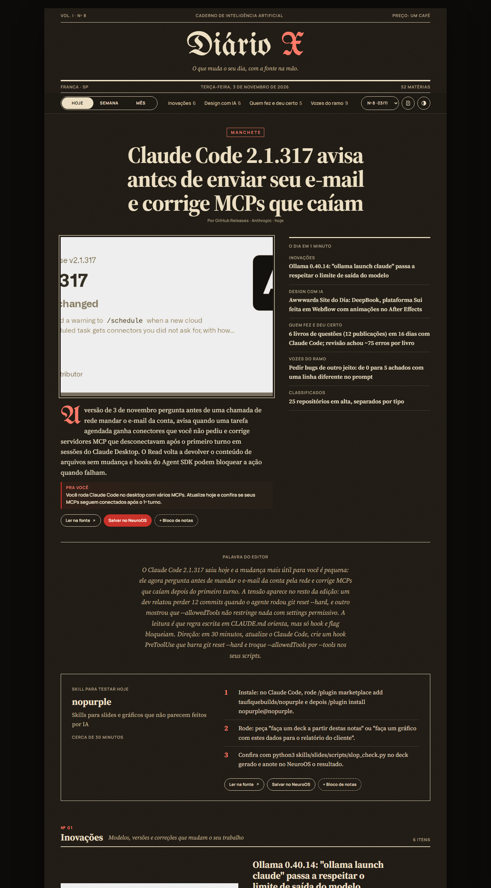
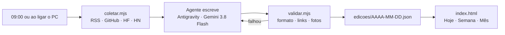

<div align="center">


# Diário X

**O que muda o seu dia, com a fonte na mão.**

Um jornal pessoal de IA que roda no seu PC. Toda manhã um agente lê RSS, GitHub, Hugging Face e Hacker News,
escreve de 45 a 55 matérias em português e entrega uma edição com cara de jornal impresso.
Cada matéria traz o link da fonte e um "pra você": o que fazer com aquilo hoje.


</div>


## O que tem em cada edição

| Seção | O que entra |
|---|---|
| **Manchete** | a notícia que mais muda o seu trabalho no dia |
| **O dia em 1 minuto** | uma linha por seção, para ler no café |
| **Inovações** | modelos novos, versões e correções de ferramentas |
| **Design com IA** | Awwwards, sites premiados e como estão sendo feitos |
| **Quem fez e deu certo** | resultados reais, com número |
| **Vozes do ramo** | especialistas de fora traduzidos (Simon Willison, Akita, Zenn…) |
| **Classificados** | repositórios do GitHub em alta, separados por tipo |
| **Skill para testar hoje** | uma skill com passo a passo de ~30 minutos |
| **Palavra do editor** | o fio que liga as matérias do dia |

Regra de ouro: **nada inventado.** Sem URL verificada, a matéria não entra. O `validar.mjs` confere formato,
links e repetição antes de a edição ir ao ar.

<table>
<tr>
<td width="62%"></td>
<td width="38%" valign="top"></td>
</tr>
<tr>
<td align="center"><sub>Manchete, resumo do dia, palavra do editor e skill do dia</sub></td>
<td align="center"><sub>No celular</sub></td>
</tr>
</table>

## Como funciona



A coleta não usa IA: só busca e organiza. O agente escolhe, escreve e liga cada item à rotina do leitor.
Se a validação falhar, o agente tenta de novo (até 3 vezes).

## Rodar

Node 18+, sem dependências.

```bash
node server.mjs          # abre em http://127.0.0.1:51810 (ou dois cliques no Diario-X.bat)
```

Montar a edição de hoje na mão:

```bash
node rodar-edicao.mjs    # coleta → agente escreve → valida
```

Agendar todo dia às 09:00 e ao ligar o PC (Windows, PowerShell):

```powershell
.\instalar-agendamento.ps1
```

### Variáveis opcionais

| Variável | Para que serve |
|---|---|
| `DIARIO_PORT` | porta do servidor (padrão `51810`) |
| `NEUROOS_INBOX` | pasta onde o botão "Salvar" grava `diario-x.jsonl` |
| `GITHUB_TOKEN` | aumenta o limite da API do GitHub na coleta |

## Recursos do leitor

- **Hoje / Semana / Mês:** a edição do dia ou a soma das anteriores
- **Salvar no NeuroOS:** manda a matéria para o segundo cérebro (`brain/inbox/diario-x.jsonl`)
- **Bloco de notas:** junta trechos enquanto lê
- **Tema claro e escuro**, navegação por teclado nas abas e edições anteriores pelo seletor de número

## Arquivos

| Arquivo | O que faz |
|---|---|
| `coletar.mjs` | RSS, GitHub (busca, trending, releases), Hugging Face, HN; sem IA |
| `rodar-edicao.mjs` | orquestra a edição com o agente, até 3 tentativas |
| `validar.mjs` | confere formato, links e repetição; preenche fotos; reescreve `edicoes/index.json` |
| `server.mjs` | serve o site e recebe o "Salvar" |
| `index.html` | o jornal inteiro, num arquivo só |
| `instalar-agendamento.ps1` | agenda `rodar-edicao.mjs` às 09:00 e ao ligar o PC |
| `docs/SKILL-diario-x.md` | regras editoriais do agente: seções, quantidades, tom e formato |
| `docs/PROMPT-ANTIGRAVITY.md` | prompt para rodar ou agendar a edição direto no Antigravity |
| `edicoes/` | uma edição por dia, em JSON |

## Adaptar para você

O jornal é pessoal: o "pra você" de cada matéria sai do **Perfil do leitor** em
[`docs/SKILL-diario-x.md`](docs/SKILL-diario-x.md). Troque esse perfil pelo seu (profissão, ferramentas,
projetos) e as próximas edições passam a falar com você.

---

<div align="center"><sub>Feito por <a href="https://github.com/VinniciusXavier">Vinicius Xavier</a> · impresso pelo agente Diário X, toda manhã às 09:00</sub></div>
