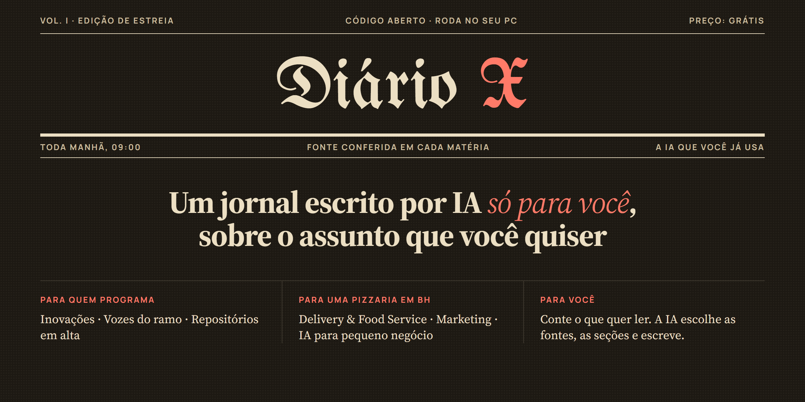
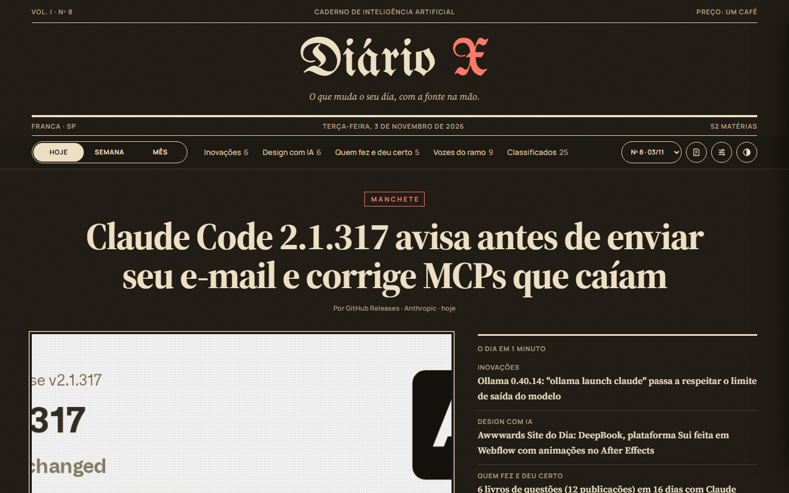
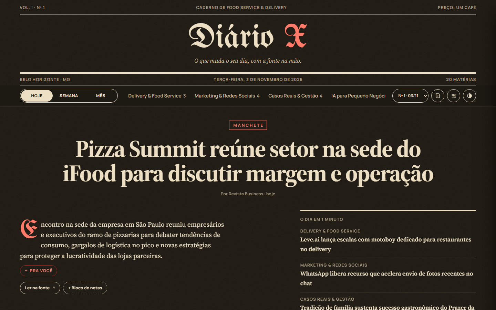
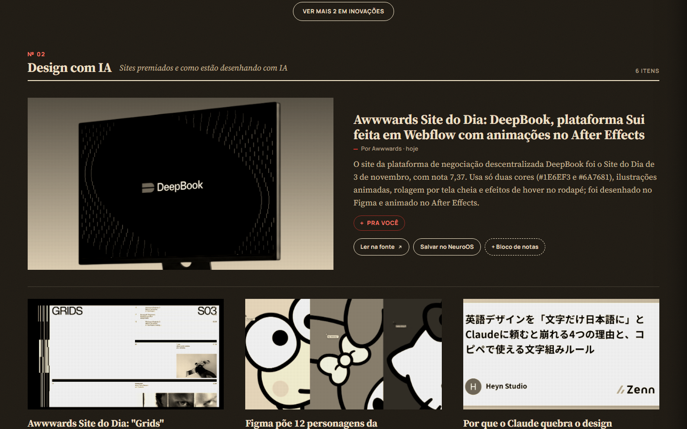
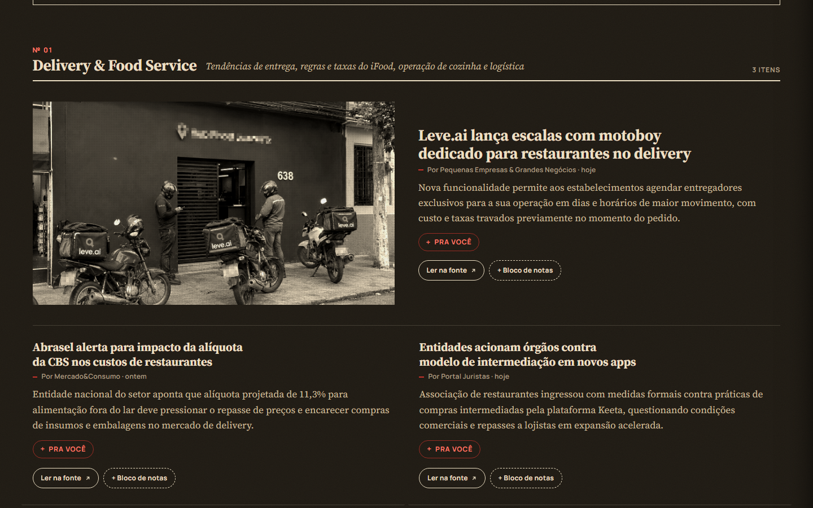
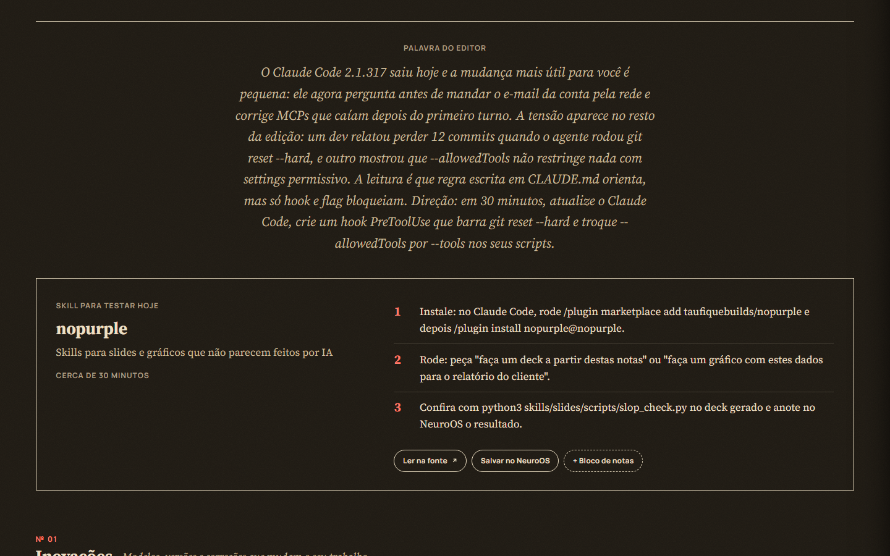
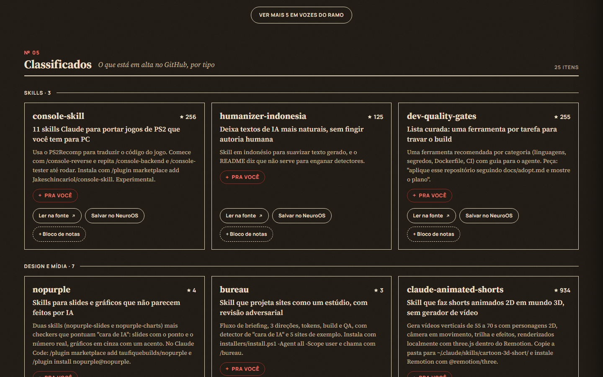
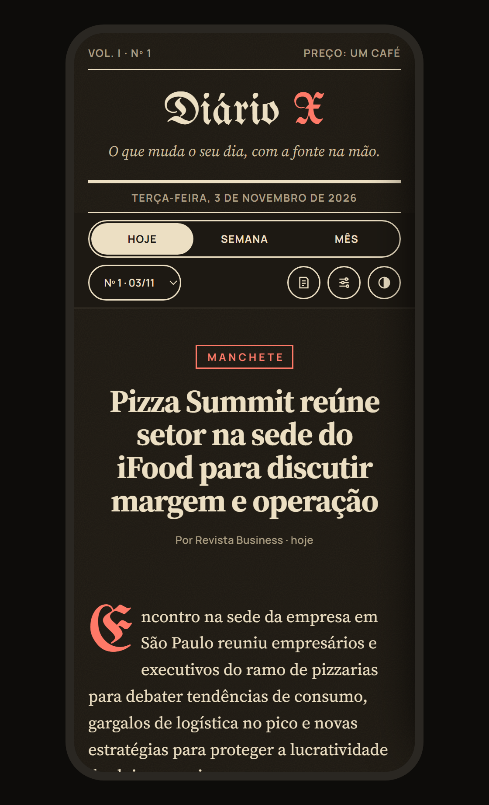
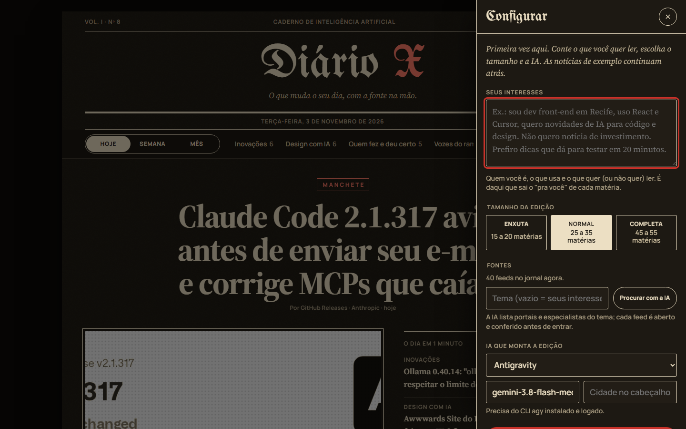
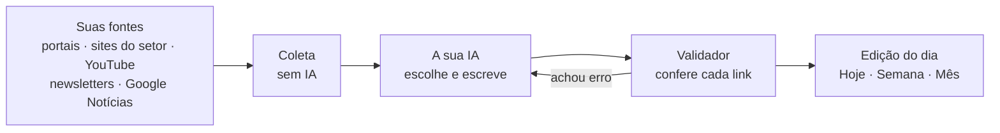

<div align="center">




**Toda manhã, uma edição nova: as notícias do seu mundo, com a fonte em cada matéria<br>e um "pra você" dizendo o que fazer com aquilo hoje.**

[Começar](#começar-em-3-passos) · [Como funciona](#como-funciona) · [Configurar](#configurar)

</div>

<br>

## O mesmo jornal, pessoas diferentes

Você conta quem é e o que quer ler. A IA escolhe as fontes, cria as seções e escreve a edição.

<table>
<tr>
<td width="50%"></td>
<td width="50%"></td>
</tr>
<tr>
<td align="center"><b>Designer que usa IA</b><br><sub>Inovações · Design com IA · Vozes do ramo · Repositórios em alta</sub></td>
<td align="center"><b>Dona de pizzaria em BH</b><br><sub>Delivery & Food Service · Marketing · IA para pequeno negócio · BH & Região</sub></td>
</tr>
</table>

## Por dentro de uma edição

<table>
<tr>
<td width="50%"></td>
<td width="50%"></td>
</tr>
<tr>
<td align="center"><sub><b>Seções com fotos</b> · o "pra você" abre com um clique</sub></td>
<td align="center"><sub><b>Seções criadas para a pessoa</b> · aqui, Delivery & Food Service</sub></td>
</tr>
<tr>
<td width="50%"></td>
<td width="50%"></td>
</tr>
<tr>
<td align="center"><sub><b>Palavra do editor</b> e algo para testar hoje, em 3 passos</sub></td>
<td align="center"><sub><b>Classificados</b> · repositórios em alta, por tipo</sub></td>
</tr>
</table>

<p align="center"><br><sub><b>No celular</b></sub></p>

## Por que é diferente

|   |   |
|---|---|
| 📰 **É um jornal, não um feed** | Manchete, "o dia em 1 minuto", palavra do editor e seções. Cabe no café da manhã. |
| 🔗 **Nada inventado** | Toda matéria tem link para a fonte. Um validador confere cada link antes da edição sair. |
| 🎯 **Escrito para você** | Cada matéria traz um "pra você": o que aquilo muda no seu dia, numa ação pequena. |
| 🤖 **Usa a IA que você já tem** | Claude Code, Gemini CLI, Codex, Antigravity, qualquer API compatível com a OpenAI ou o Ollama no seu PC. |
| 🏠 **Roda no seu computador** | Sem conta, sem servidor, sem dependências. Só Node. |

## Começar em 3 passos

```bash
git clone https://github.com/VinniciusXavier/diario-x.git && cd diario-x
```

```bash
node server.mjs
```

Abra **http://127.0.0.1:51810**. Na primeira vez o painel **Configurar** abre sozinho: escreva seus interesses,
escolha o tamanho e a IA, clique em **Procurar com a IA** e depois em **Usar as fontes aprovadas**.



Para montar a edição de hoje:

```bash
node rodar-edicao.mjs
```

> No Windows, `.\instalar-agendamento.ps1` deixa a edição pronta todo dia às 09:00 e quando o PC liga.

## Como funciona



A coleta só busca e organiza: não gasta IA. A IA escolhe as melhores matérias, escreve em português e liga cada uma
à sua rotina. Se o validador achar um problema, ela recebe a lista de erros e corrige, até 3 vezes.

## Configurar

Tudo pode ser feito pelo painel do jornal. Quem preferir edita o `config.json` (o modelo é o
[`config.exemplo.json`](config.exemplo.json)).

<details>
<summary><b>Qual IA monta a edição</b></summary>

<br>

| `provedor` | Precisa de | Abre páginas sozinha? |
|---|---|---|
| `antigravity` | CLI `agy` instalado e logado | sim |
| `claude` | [Claude Code](https://claude.com/claude-code) logado | sim |
| `gemini` | [Gemini CLI](https://github.com/google-gemini/gemini-cli) logado | sim |
| `codex` | [Codex CLI](https://github.com/openai/codex) logado | sim |
| `api` | qualquer API no formato da OpenAI: OpenAI, OpenRouter, Groq, DeepSeek, Ollama… | não, usa só a coleta |
| `comando` | qualquer outro CLI | depende do CLI |

```jsonc
"ia": { "provedor": "claude", "modelo": "claude-sonnet-5-5" }

// a chave fica numa variável de ambiente, nunca no arquivo
"ia": { "provedor": "api", "modelo": "gpt-5", "api": { "url": "https://api.openai.com/v1", "chave_env": "OPENAI_API_KEY" } }

// Ollama no seu PC, sem chave
"ia": { "provedor": "api", "modelo": "qwen3:32b", "api": { "url": "http://localhost:11434/v1" } }

// outro CLI: {pedido}, {modelo} e {pasta_skill} são trocados na hora
"ia": { "provedor": "comando", "comando": "meu-agente", "args": ["--model", "{modelo}", "{pedido}"] }
```

Com `api` a IA não navega: a coleta vai inteira na mensagem, então use um modelo com pelo menos 64 mil tokens de contexto.
Para conferir sem gastar nada: `node rodar-edicao.mjs --simular`.

</details>

<details>
<summary><b>Para quem o jornal escreve e quantas notícias</b></summary>

<br>

- **`leitor`**: um parágrafo sobre você (profissão, ferramentas, cidade, o que quer e o que não quer ler). É daí que
  sai o "pra você".
- **`edicao.tamanho`**: `enxuta` (15 a 20 matérias), `normal` (25 a 35) ou `completa` (45 a 55).
- **`cidade`**: aparece no cabeçalho, ao lado da data.

</details>

<details>
<summary><b>Seções e caderno</b></summary>

<br>

Quando a IA procura as fontes e você escolhe **trocar**, ela também cria as seções e o nome do caderno pensados para
você. Cada edição guarda as seções com que foi feita, então mudar depois não bagunça as edições antigas.

```json
"caderno": "Caderno de Food Service & Delivery",
"secoes": [{ "id": "delivery", "nome": "Delivery & Food Service", "sub": "Mercado, apps e tendências do setor" }]
```

Sem `secoes`, valem as de tecnologia: Inovações, Design com IA, Quem fez e deu certo, Vozes do ramo e Classificados.

</details>

<details>
<summary><b>De onde vêm as notícias</b></summary>

<br>

| Campo | O que é |
|---|---|
| `rss` | qualquer feed: portais, sites do setor, blogs, newsletters (Substack, Medium), YouTube, subreddits, podcasts |
| `google_noticias` | buscas no Google Notícias, ex.: `"delivery de comida"`; pega qualquer portal que falou disso na semana |
| `github_buscas` · `github_releases` · `hacker_news` | para quem é de tecnologia |
| `github_trending` · `hugging_face` | `true` ou `false` |

Pelo terminal:

```bash
node fontes.mjs adicionar meioemensagem.com.br --tipo imprensa   # você sugere um site; o script acha o feed
node fontes.mjs descobrir "tenho uma pizzaria delivery em BH"     # a IA procura onde alguém assim se informa
node fontes.mjs aplicar --substituir                             # troca as fontes (sem a opção: soma)
node fontes.mjs testar                                           # mostra os feeds quebrados
```

Toda fonte é aberta e conferida antes de entrar: endereço inventado não passa. LinkedIn, Instagram, Facebook, X e
TikTok não têm feed aberto; no lugar, vale o blog, a newsletter ou o YouTube da mesma pessoa ou empresa.

</details>

<details>
<summary><b>Variáveis de ambiente</b></summary>

<br>

| Variável | Para que serve |
|---|---|
| `DIARIO_PORT` | porta do servidor (padrão `51810`) |
| `DIARIO_MODELO` | troca o modelo do config só nesta execução |
| `GITHUB_TOKEN` | aumenta o limite da API do GitHub na coleta |
| `NEUROOS_INBOX` | com `"neuroos": true`, pasta do botão "Salvar no NeuroOS" (o segundo cérebro do autor) |

</details>

<details>
<summary><b>Arquivos do projeto</b></summary>

<br>

| Arquivo | O que faz |
|---|---|
| `index.html` | o jornal inteiro, num arquivo só |
| `server.mjs` | serve o jornal, grava o painel Configurar e roda a busca de fontes |
| `coletar.mjs` | lê as fontes do config, sem IA |
| `rodar-edicao.mjs` | chama a IA, valida e tenta de novo |
| `validar.mjs` | confere formato e links, preenche as fotos e atualiza o índice |
| `fontes.mjs` | adiciona, descobre com IA e testa fontes |
| `ia.mjs` · `config.mjs` | falam com a IA e leem o `config.json` |
| `docs/SKILL-diario-x.md` | regras editoriais: tom, formato e seções padrão |
| `edicoes/` | uma edição por dia, em JSON (as que vêm no repositório são de exemplo) |

</details>

## Começar do zero

As edições que vêm no repositório são de exemplo. Para o seu jornal começar do nº 1, apague os arquivos de `edicoes/`
e deixe o `index.json` como `{ "edicoes": [] }`.

---

<div align="center">
<sub>Feito por <a href="https://github.com/VinniciusXavier">Vinicius Xavier</a>, designer. Gostou? Deixe uma ⭐ e mande para alguém que vive sem tempo de ler notícia.</sub>
</div>
