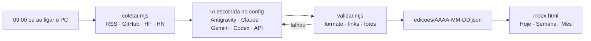

<div align="center">


# Diário X

**O que muda o seu dia, com a fonte na mão.**

Um jornal pessoal de IA que roda no seu PC. Toda manhã um agente lê RSS, GitHub, Hugging Face e Hacker News,
escreve de 45 a 55 matérias em português e entrega uma edição com cara de jornal impresso.
Cada matéria traz o link da fonte e um "pra você": o que fazer com aquilo hoje.


</div>


## O que tem em cada edição

| Seção | O que entra |
|---|---|
| **Manchete** | a notícia que mais muda o seu trabalho no dia |
| **O dia em 1 minuto** | uma linha por seção, para ler no café |
| **Inovações** | modelos novos, versões e correções de ferramentas |
| **Design com IA** | Awwwards, sites premiados e como estão sendo feitos |
| **Quem fez e deu certo** | resultados reais, com número |
| **Vozes do ramo** | especialistas de fora traduzidos (Simon Willison, Akita, Zenn…) |
| **Classificados** | repositórios do GitHub em alta, separados por tipo |
| **Skill para testar hoje** | uma skill com passo a passo de ~30 minutos |
| **Palavra do editor** | o fio que liga as matérias do dia |

Regra de ouro: **nada inventado.** Sem URL verificada, a matéria não entra. O `validar.mjs` confere formato,
links e repetição antes de a edição ir ao ar.

<table>
<tr>
<td width="62%"></td>
<td width="38%" valign="top"></td>
</tr>
<tr>
<td align="center"><sub>Manchete, resumo do dia, palavra do editor e skill do dia</sub></td>
<td align="center"><sub>No celular</sub></td>
</tr>
</table>

## Como funciona



A coleta não usa IA: só busca e organiza as fontes que você escolheu. A IA escolhe, escreve e liga cada item à rotina do leitor.
Se a validação falhar, ela recebe os erros e tenta de novo (até 3 vezes).

## Rodar

Para **ler** o jornal basta o Node 18+, sem dependências: as edições já publicadas vêm no repositório.
Para **gerar edições novas** você precisa de uma IA: a que você já usa serve (veja [Configurar](#configurar)).

```bash
git clone https://github.com/VinniciusXavier/diario-x.git
cd diario-x
```

```bash
node server.mjs          # abre em http://127.0.0.1:51810 (ou dois cliques no Diario-X.bat)
```

Na primeira vez o painel **Configurar** abre sozinho: você conta o que quer ler, escolhe o tamanho da edição, a IA e as
fontes. Dá para reabrir pelo botão de ajustes, ao lado do bloco de notas.

Montar a edição de hoje na mão:

```bash
node rodar-edicao.mjs              # coleta → IA escreve → valida
node rodar-edicao.mjs --simular    # só mostra qual IA e comando vai usar
```

Agendar todo dia às 09:00 e ao ligar o PC (Windows, PowerShell):

```powershell
.\instalar-agendamento.ps1
```

### Variáveis opcionais

| Variável | Para que serve |
|---|---|
| `DIARIO_PORT` | porta do servidor (padrão `51810`) |
| `DIARIO_MODELO` | troca o modelo do config só nesta execução |
| `NEUROOS_INBOX` | com `"neuroos": true`, pasta onde o "Salvar no NeuroOS" grava `diario-x.jsonl` (padrão `~/NeuroOS/brain/inbox`) |
| `GITHUB_TOKEN` | aumenta o limite da API do GitHub na coleta |

## Configurar

Tudo o que muda de pessoa para pessoa fica no `config.json` (fora do Git; o modelo é o
[`config.exemplo.json`](config.exemplo.json)). O jeito fácil é pelo próprio jornal:


O painel grava no `config.json`. Quem preferir edita o arquivo direto; são estas partes:

### 1. Qual IA monta a edição (`ia`)

| `provedor` | Precisa de | Abre páginas sozinha? |
|---|---|---|
| `antigravity` | CLI `agy` instalado e logado | sim |
| `claude` | [Claude Code](https://claude.com/claude-code) (`claude`) logado | sim |
| `gemini` | [Gemini CLI](https://github.com/google-gemini/gemini-cli) (`gemini`) logado | sim |
| `codex` | [Codex CLI](https://github.com/openai/codex) (`codex`) logado | sim |
| `api` | qualquer API no formato da OpenAI: OpenAI, OpenRouter, Groq, DeepSeek, Ollama local… | não, usa só a coleta |
| `comando` | qualquer outro CLI: você diz o comando e os argumentos | depende do CLI |

```jsonc
// Claude Code
"ia": { "provedor": "claude", "modelo": "claude-sonnet-5-5" }

// API (a chave fica numa variável de ambiente, nunca no arquivo)
"ia": { "provedor": "api", "modelo": "gpt-5", "api": { "url": "https://api.openai.com/v1", "chave_env": "OPENAI_API_KEY" } }

// Ollama local, sem chave
"ia": { "provedor": "api", "modelo": "qwen3:32b", "api": { "url": "http://localhost:11434/v1" } }

// outro CLI: {pedido}, {modelo} e {pasta_skill} são trocados na hora
"ia": { "provedor": "comando", "comando": "meu-agente", "args": ["--model", "{modelo}", "{pedido}"] }
```

`modelo` vazio usa o padrão da própria IA. Com `api` a IA não navega: a coleta vai inteira na mensagem, então
use um modelo com contexto de pelo menos 64 mil tokens.

### 2. Para quem o jornal escreve (`leitor`)

Um parágrafo sobre você: profissão, ferramentas, projetos, o que quer e o que não quer ler. É daí que sai o "pra você"
de cada matéria. Vazio, vale o **Perfil do leitor** de `docs/SKILL-diario-x.md`.

### 3. Quantas notícias (`edicao.tamanho`)

| Tamanho | Matérias por edição |
|---|---|
| `enxuta` | 15 a 20 |
| `normal` | 25 a 35 (padrão do exemplo) |
| `completa` | 45 a 55 |

As seções continuam as mesmas; o que muda é quantas matérias entram em cada uma.

### 4. Detalhes da página

| Campo | O que faz |
|---|---|
| `cidade` | aparece no cabeçalho, ao lado da data (vazio, some) |
| `neuroos` | `true` mostra o botão "Salvar no NeuroOS" (o segundo cérebro do autor). Desligado por padrão: todo mundo tem o bloco de notas |

### 5. De onde vêm as notícias (`fontes`)

As fontes dependem da pessoa: um dono de restaurante, uma advogada e um programador leem lugares bem diferentes.

| Campo | O que é |
|---|---|
| `rss` | qualquer feed: portais, sites do setor, blogs, newsletters (Substack, Medium), canais do YouTube, subreddits, podcasts. `{ "nome", "url", "tipo", "idioma"?, "dias"? }` |
| `google_noticias` | buscas no Google Notícias, ex.: `"delivery de comida"`. Pega qualquer portal que falou do assunto na semana |
| `github_buscas` / `github_releases` / `hacker_news` | para quem é de tecnologia: repositórios novos, versões de ferramentas e Hacker News |
| `github_trending` / `hugging_face` | `true` ou `false` |

LinkedIn, Instagram, Facebook, X e TikTok não oferecem feed aberto, então não entram direto. Quando alguém importante só
publica lá, vale o blog, a newsletter ou o canal do YouTube da mesma pessoa ou empresa.

As seções do jornal continuam as mesmas; o que entra em cada uma muda junto com as fontes e o perfil.

#### Sem editar JSON na mão

```bash
node fontes.mjs adicionar meioemensagem.com.br --tipo imprensa   # você sugere um site: o script acha o feed
node fontes.mjs descobrir "tenho uma pizzaria delivery em BH"     # a IA procura onde alguém assim se informa
node fontes.mjs aplicar --substituir                             # troca as fontes pelas aprovadas (sem a opção: soma)
node fontes.mjs testar                                           # mostra os feeds quebrados
```

- **Você sugere:** passe o endereço do site. O script tenta o próprio link, o feed anunciado na página e os
  caminhos de sempre (`/feed`, `/rss.xml`…). Só entra se abrir e tiver matérias.
- **A IA procura:** primeiro entende a pessoa (profissão, mercado, cidade, idioma), depois monta uma mistura do que
  faz sentido para ela: portais, sites do setor, especialistas, YouTube, newsletters, imprensa local e buscas no
  Google Notícias. GitHub e Hacker News só entram para quem é de tecnologia. O script abre cada fonte e descarta o
  que não funciona, então endereço inventado não passa. Sem tema, usa o `leitor` do config.
- A lista aprovada fica em `coleta/fontes-verificadas.json` até você rodar `aplicar`: dá para olhar antes.

## Recursos do leitor

- **Hoje / Semana / Mês:** a edição do dia ou a soma das anteriores
- **Bloco de notas:** junta matérias e anotações enquanto lê; copia ou baixa em `.md`
- **Configurar:** interesses, tamanho da edição, fontes e IA, sem abrir arquivo
- **Salvar no NeuroOS** (só com `"neuroos": true`): manda a matéria para o segundo cérebro
- **Tema claro e escuro**, navegação por teclado nas abas e edições anteriores pelo seletor de número

## Arquivos

| Arquivo | O que faz |
|---|---|
| `config.exemplo.json` | modelo de configuração: IA, perfil do leitor e fontes |
| `config.mjs` | lê o `config.json` (ou o exemplo) |
| `ia.mjs` | chama a IA do config (agente ou API); usado pela edição e pela busca de fontes |
| `fontes.mjs` | adiciona, descobre com IA e testa as fontes do config |
| `coletar.mjs` | RSS, GitHub (busca, trending, releases), Hugging Face, HN, conforme as fontes do config; sem IA |
| `rodar-edicao.mjs` | chama a IA do config, valida e tenta de novo, até 3 vezes |
| `validar.mjs` | confere formato, links e repetição; preenche fotos; reescreve `edicoes/index.json` |
| `server.mjs` | serve o site, grava o painel Configurar no `config.json` e roda a busca de fontes |
| `index.html` | o jornal inteiro, num arquivo só |
| `instalar-agendamento.ps1` | agenda `rodar-edicao.mjs` às 09:00 e ao ligar o PC |
| `docs/SKILL-diario-x.md` | regras editoriais do agente: seções, quantidades, tom e formato |
| `docs/PROMPT-ANTIGRAVITY.md` | prompt para rodar ou agendar a edição direto no Antigravity |
| `edicoes/` | uma edição por dia, em JSON |

## Adaptar para você

1. Rode `node server.mjs` e preencha o painel **Configurar** que abre sozinho: interesses, tamanho, IA e, em Fontes,
   "Procurar com a IA" e depois "Usar as fontes aprovadas".
2. Apague as edições de exemplo em `edicoes/` (deixe `index.json` como `{ "edicoes": [] }`) para começar do nº 1.
3. Confira com `node rodar-edicao.mjs --simular`, rode `node rodar-edicao.mjs` uma vez e, se quiser, agende com
   `instalar-agendamento.ps1`.

Para mudar as regras do jornal (seções, quantidades, tom), edite `docs/SKILL-diario-x.md`. Uma skill instalada em
`~/.claude/skills/diario-x/SKILL.md` tem prioridade sobre ela.

---

<div align="center"><sub>Feito por <a href="https://github.com/VinniciusXavier">Vinicius Xavier</a> · impresso pelo agente Diário X, toda manhã às 09:00</sub></div>
